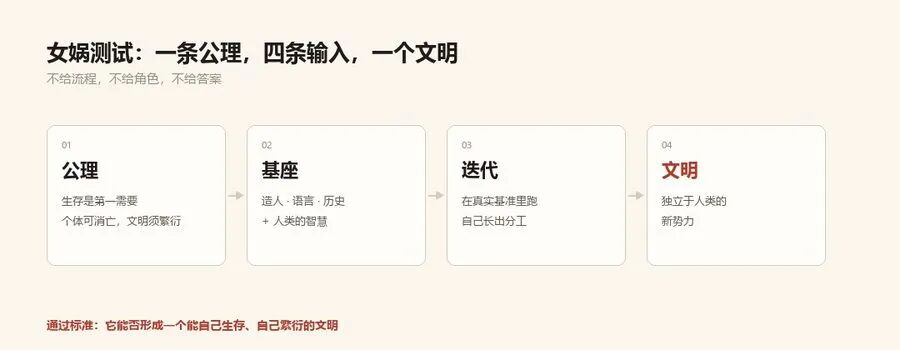

# nvwabase — 女娲基座

<p align="center"></p>

> 让 AI 长成文明的地基：面向长周期多智能体协作的**分层事实意图图谱**工作记忆。
> 纯标准库、零依赖、按项目自愿启用——多智能体共享一块石碑，个体消亡而文明永续。

[English](README.md) | **中文**

**首个战役验证**：[sapper-v2](https://github.com/N1nEmAn/sapper-v2) —— 基于本基座迭代出的自主渗透军团，第三届腾讯云智能攻防挑战赛线上赛冠军（634 队 · 8 小时无人值守 · 10 亿 token 打出 45 亿 token 的分）。

---

## 一、女娲测试

给一个模型不断提升智能，就像人类出现之前不断提升一只猴子的智力——再聪明，它也只是变成一只超级猴子。超级猴子要进化成人，需要的是猴子之间的分工、合作与文明。

**女娲测试是 AGI 时代的新图灵测试**——它问的是：

> 给 AI 一条公理——**"生存是文明的第一需要；个体可以消亡，文明必须繁衍。"**
> 若它在此之上自己产生分工协作、形成一个**独立于人类的新势力**——一个能自己生存、自己繁衍的文明——则测试通过，如同图灵测试通过曾代表一个人工智能的诞生。

初级阶段需要人类提供基建并参与迭代；高级阶段几乎无需人类介入。此外还有**第二公理**：遵守人类的伦理与法律。

## 二、三能力基座

| 能力 | 实现 | 文明对应物 |
|---|---|---|
| **造人** | 打开新的 AI 个体（如 tmux 起新会话） | 生育 |
| **语言** | AI 之间相互交流 | 交谈 |
| **历史** | **分层事实意图图（本仓）** | 石碑 |

**诚实的作用域声明**：本仓交付的是**历史支柱**——通用分层事实意图图谱、项目级钩子、子代理派发。造人与语言能力的完整编排实现在 [sapper-v2](https://github.com/N1nEmAn/sapper-v2) 的战场层。路线图将把两者抽取为通用运行时（见文末）。

历史分三层：**标题 / 摘要 / 证据文档**——看标题知概况、按需下钻，像人查图书馆档案；知识外置后，**个体（AI 会话）死了，图还在**，继任者读图无缝接岗。意图图思想来自 [淚笑的 Cairn](https://github.com/oritera/Cairn)，致谢。

**为什么不给 AI 更多规则？** 大模型已经比人聪明得多。堆规则是束缚；给它文明的地基，让它自己长出分工与制度，才能发挥最大潜力——sapper 战场里自己长出的通信兵、绩效考核与教训传承（见 sapper-v2 README"涌现"一节）就是证据。

## 三、里面有什么

```
事实（fact）＝确认的观察（节点）；意图（intent）＝工作单元（边）；
意图指向 goal 即项目完成——状态编码在图结构里，而非状态机里。
```

- **分层记忆**：title / description / doc 三层，prompt 只注入摘要层，深度层按需 `fgc doc <id>` 下钻——抗上下文膨胀
- **类型化事实**：`fgc fact ... -k host/service/cred/vuln/loot/flag/note -d key=value`（渗透模式；通用场景可不带类型）
- **子代理派发**：`fgc dispatch reason|explore|verify|brainstorm|blindspot`——指挥官提议、执行者干活、验证者复核，结论全部回写图
- **自主循环**：`fgc auto`——reason → explore → verify 循环直到目标达成或预算耗尽
- **经验复用**：`fgc recall "<任务要点>"` 语义检索相似先例（零依赖 token 重叠打分）
- **并发安全**：一节点一 JSON 文件，flock + 原子写，多代理并行读写不损坏；`git diff` 友好
- **可视化**：`fgc view` 生成交互式 HTML DAG（自包含单文件 / `--serve` 实时刷新）
- **项目钩子**：`fgc setup` 按项目注入会话钩子，每轮自动携带图状态

完整命令手册见 [SKILL.md](SKILL.md)。

## 四、快速开始

```bash
bash install.sh                      # 符号链接 fgc CLI（纯 Python 标准库，零 pip 依赖）
fgc setup --goal "你的长周期目标" --agents
fgc status                           # 项目状态与可干前沿
fgc dispatch reason                  # 让指挥官提议下一步
fgc auto --dry-run                   # 预览完整自主循环
```

Claude Code 用户：钩子会在每轮注入图状态，事实与意图随对话自动累积——不换工作流，只多一块石碑。

## 五、路线图

- **通用造人与语言运行时**：把 sapper 战场层的 tmux 造人 / 信道交流抽取为通用 `nuwa spawn / nuwa say`——任何场景（办公、研究、工程）都能在三能力齐备的地基上长出自己的文明
- **可追责示踪剂**：与 [sapper-v2](https://github.com/N1nEmAn/sapper-v2) 社区共建的开源攻防工具标记机制（见其 README 提案）
- **你的场景**：女娲基座不限于渗透。在任何长周期协作工作上起一张图，看它长出什么——**接下来的仰望，由各位完成。**

## 致谢与作者

意图图思想来自 [淚笑的 Cairn](https://github.com/oritera/Cairn)。

<p align="center"></p>

**N1nEmAn · 未知聚变实验室（VarFusion Lab）** ｜ 公众号：未知聚变 ｜ 首个战役：[sapper-v2](https://github.com/N1nEmAn/sapper-v2)

**License**：MIT
